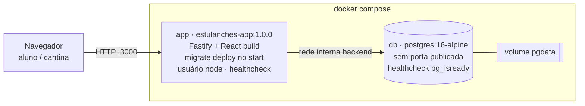

# EstuLanches

Cardápio online e fila de pedidos para a cantina da escola. O aluno pede pelo celular e acompanha o status; a cantina vê a fila, avança os pedidos e controla o estoque.

**Problema que resolve:** fila no intervalo, pedido anotado em papel, erro de troco/total e produto vendido sem estoque.

> Vídeo de apresentação: _[link do vídeo]_

## Arquitetura

Dois containers: a **aplicação** (API Fastify que também serve o front React já compilado) e o **PostgreSQL**. Só a porta 3000 da aplicação é publicada; o banco fica isolado numa rede interna e guarda os dados no volume `pgdata`.



| Camada | Tecnologia |
|---|---|
| Front-end | React + Vite + TypeScript, CSS próprio, React Router |
| API | Node.js 22 + Fastify 5, logger pino (JSON) |
| Validação | Zod |
| Banco / ORM | PostgreSQL 16 + Prisma (migrations versionadas) |
| Autenticação | JWT (`@fastify/jwt`) + bcrypt |
| Segurança HTTP | `@fastify/helmet`, `@fastify/rate-limit`, `@fastify/cors` |
| Testes | Vitest + `fastify.inject()` + cobertura v8 |
| Infra | Dockerfile multi-stage + Docker Compose |

## Como rodar

Pré-requisito: Docker Desktop (ou Docker Engine + Compose v2).

```bash
cp .env.example .env        # no PowerShell: Copy-Item .env.example .env
# edite o .env e troque TODOS os valores "troque-isto..."
docker compose up -d --build
```

Acesse **http://localhost:3000**. Na primeira subida o container aplica as migrations e, com `SEED=true`, cria os dados de demonstração.

```bash
docker compose ps                    # app e db devem aparecer como "healthy"
docker compose logs app --tail=50    # migrations aplicadas + servidor ouvindo
curl http://localhost:3000/api/health
docker compose down                  # para tudo (os dados continuam no volume)
```

### Usuários de demonstração

| Perfil | E-mail | Senha |
|---|---|---|
| Cantina (ADMIN) | `cantina@estulanches.local` | valor de `SEED_ADMIN_PASSWORD` no `.env` |
| Aluno | `aluno@estulanches.local` | valor de `SEED_ALUNO_PASSWORD` no `.env` |

Novos alunos podem se cadastrar pela tela de cadastro (o cadastro público sempre cria perfil ALUNO).

## Testes

Os testes rodam dentro do Docker, contra um PostgreSQL descartável (em memória):

```bash
docker compose --profile test run --rm tests
```

- **Unitários** (`backend/tests/unit`, sem banco): cálculo do total com Decimal, transições de status válidas e inválidas, verificação de estoque, schemas Zod e hash de senha.
- **Integração** (`backend/tests/integration`): sobe a API inteira com `buildApp()` + `inject()` contra o banco real. Cobre login, permissões (401/403), criação de pedido com baixa de estoque, preço enviado pelo cliente ignorado, pedido acima do estoque (409 com rollback), transições (200/422), cancelamento com devolução de estoque e isolamento entre alunos (404).
- **Cobertura:** meta ≥ 70% em `src/domain` e `src/modules/**/service.ts`, configurada como `thresholds` no Vitest. Se a cobertura cair abaixo disso, o comando falha.

## Endpoints (prefixo `/api`)

| Método | Rota | Acesso | Resposta |
|---|---|---|---|
| GET | `/health` | público | 200 `{status:"ok",db:"up"}` ou 503 |
| POST | `/auth/register` | público | 201 `{token, usuario}` (sempre ALUNO) |
| POST | `/auth/login` | público, 5/min por IP | 200 `{token, usuario}` / 401 |
| GET | `/categorias` | público | 200 lista |
| POST · PUT · DELETE | `/categorias[/:id]` | ADMIN | 201 / 200 / 204; 409 se tiver produtos |
| GET | `/produtos?categoriaId=` | público | 200 só ativos com estoque > 0 |
| GET | `/admin/produtos` | ADMIN | 200 todos, inclusive inativos |
| POST · PUT | `/produtos[/:id]` | ADMIN | 201 / 200 |
| DELETE | `/produtos/:id` | ADMIN | 204 (exclusão lógica: `ativo = false`) |
| POST | `/pedidos` | ALUNO | 201; 400 inválido; 409 sem estoque |
| GET | `/pedidos/meus` | ALUNO | 200 pedidos do usuário logado |
| PATCH | `/pedidos/:id/cancelar` | ALUNO dono ou ADMIN | 200; 404 se for de outro aluno; 422 fora do status permitido |
| GET | `/pedidos?status=` | ADMIN | 200 fila |
| PATCH | `/pedidos/:id/status` | ADMIN | 200; 422 transição inválida |

Erros sempre no formato `{ "erro": { "codigo": "ESTOQUE_INSUFICIENTE", "mensagem": "..." } }`.

**Fluxo do pedido:** `RECEBIDO → EM_PREPARO → PRONTO → ENTREGUE`. O pedido pode ser cancelado em `RECEBIDO` (aluno ou cantina) ou `EM_PREPARO` (só a cantina), e o estoque volta. Qualquer outra transição responde 422.

## Decisões de segurança

| Ameaça | Defesa |
|---|---|
| Vazamento de senha | bcrypt (custo 10); a senha nunca volta na API nem aparece em log (`redact` do pino) |
| Acesso indevido | JWT com expiração de 8 h; middleware de papel ADMIN/ALUNO; aluno só enxerga os próprios pedidos (o de outro aluno responde 404) |
| Fraude de preço | o cliente envia só `produtoId` e `quantidade`; preço e total vêm do banco |
| Venda sem estoque / corrida | transação com `UPDATE ... WHERE estoque >= qtd`; se um item falhar, rollback total |
| SQL injection | Prisma com queries parametrizadas; toda entrada validada por Zod |
| Força bruta no login | rate limit de 5 tentativas/min por IP |
| Headers inseguros / CORS | Helmet; CORS restrito à origem configurada |
| Segredo no GitHub | `.env` no `.gitignore` e no `.dockerignore`; só `.env.example` é versionado; a app recusa subir com `JWT_SECRET` < 32 caracteres |
| Container comprometido | usuário não-root, sem devDependencies, limites de CPU/memória |
| Banco exposto | Postgres sem porta publicada, numa rede interna sem saída para a internet |

**Limitações conhecidas:** não há HTTPS localmente (em produção o TLS ficaria num proxy reverso/balanceador). O token fica no `localStorage`, que é vulnerável a XSS; a evolução seria um cookie `httpOnly`.

## Escalabilidade (conceitual)

Meta de referência: 1 milhão de contas e 100 mil usuários simultâneos no Brasil.

- **API sem estado (JWT):** qualquer réplica atende qualquer usuário, então escalar é adicionar réplicas atrás de um balanceador (HTTPS, WAF, rate limit), com autoescala em Kubernetes por CPU e requisições.
- **Conta de guardanapo:** 100 mil usuários fazendo ~1 requisição a cada 10 s dão ≈ 10 mil req/s. A ~500 req/s por réplica, são ~20 réplicas (~30 com folga). Escritas: 100 mil pedidos em 20 min de intervalo ≈ 83 pedidos/s em média, com picos de algumas centenas.
- **Front-end numa CDN.** O cardápio, muito lido e pouco alterado, fica em cache no Redis (TTL curto).
- **Banco é o gargalo a proteger:** PostgreSQL gerenciado multi-AZ com backup automático, PgBouncer (pool de conexões), primário para escritas e réplicas para leituras.
- **Fila de pedidos** para absorver a rajada do intervalo, já que o pico acontece em horários parecidos no país inteiro.
- **Multi-escola:** coluna `escola_id` nas tabelas.
- **Região São Paulo** com múltiplas zonas de disponibilidade e observabilidade (métricas no Prometheus, painéis no Grafana, logs centralizados, alertas de erro e latência).

## Estrutura

```
├── Dockerfile              # multi-stage: web-build → api-build → test → runtime
├── docker-compose.yml      # db + app (+ db-test e tests no profile "test")
├── .env.example            # modelo de configuração, sem segredos reais
├── backend/
│   ├── docker-entrypoint.sh   # migrate deploy → seed opcional → start
│   ├── prisma/                # schema, migrations (inclui CHECK constraints), seed
│   ├── src/
│   │   ├── app.ts             # buildApp(): plugins + rotas (usado nos testes)
│   │   ├── server.ts          # listen + graceful shutdown
│   │   ├── config/env.ts      # valida variáveis de ambiente (falha rápido)
│   │   ├── plugins/           # prisma, auth (JWT + papel), error handler
│   │   ├── domain/            # regras puras: total, transições, estoque, senha
│   │   └── modules/           # auth, categorias, produtos, pedidos (rotas + service + schemas)
│   └── tests/{unit,integration}
├── frontend/src/           # páginas, componentes, cliente da API
└── docs/                   # RDM e evidências da implantação
```
